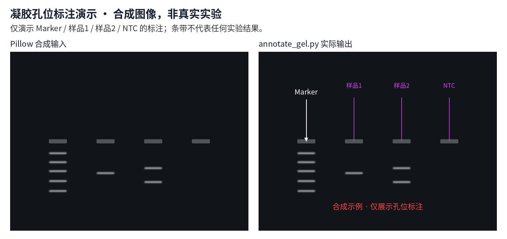
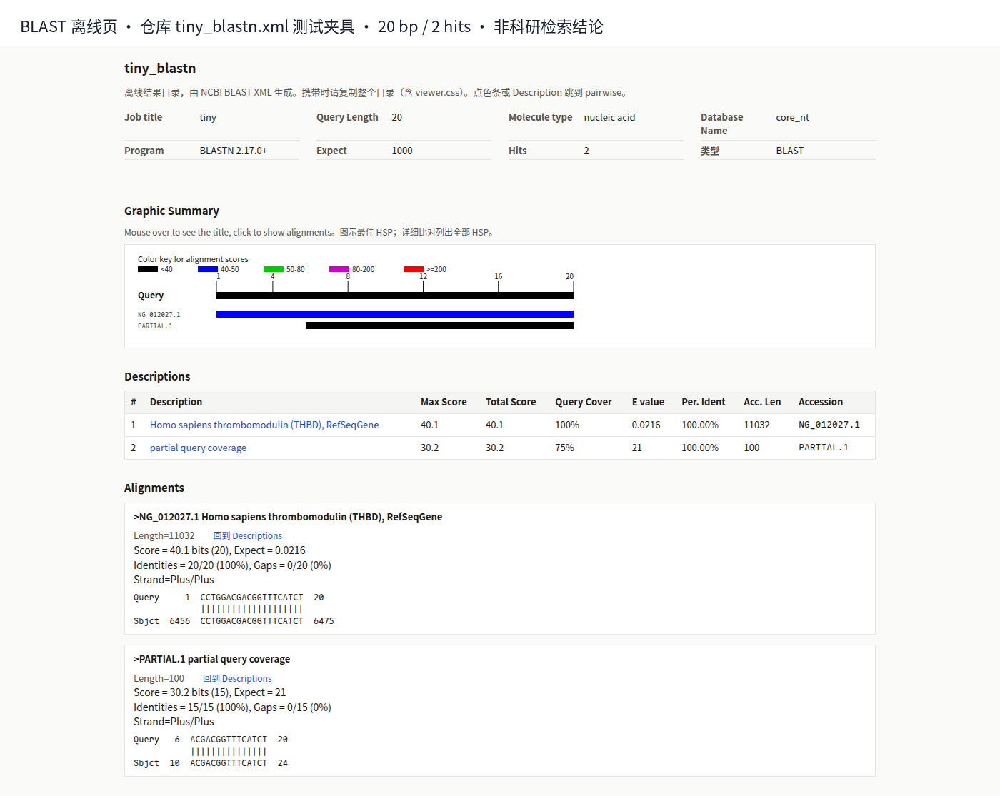
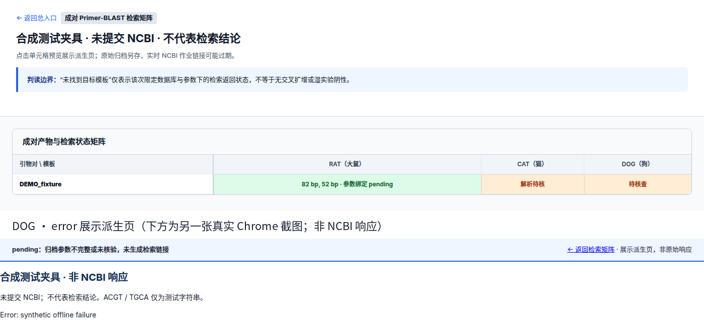

# own-skills

裴崎的 [OpenCode](https://opencode.ai) 自制 skills：凝胶标注、BLAST 离线展示、成对 Primer-BLAST 检索、GDV 基因座证据归档，以及单篇论文原图 PPT。

本仓库保存技能源码；按需复制到 OpenCode 的 skills 目录后使用。科学技能需要本次真实输入、身份与来源核查，不是安装后就能替你完成科学判断的通用工具。

## 总览

| 技能 | 用途 | 主要产物 |
| --- | --- | --- |
| [gel-annotation](#gel-annotation) | 给凝胶原图标孔位与泳道身份 | 标注 PNG、回放与检查记录 |
| [blast-offline-html](#blast-offline-html) | 展示已有单 query BLASTN XML | 可断网打开的 HTML 与 CSS |
| [primer-blast-results](#primer-blast-results) | 成对 F/R Primer-BLAST 检索与报告归档 | 离线矩阵、原始响应、展示报告与哈希清单 |
| [gdv-offline-evidence](#gdv-offline-evidence) | 归档真实官方轨道并渲染基因座证据图 | PDF、SVG、PNG 与来源记录 |
| [paper2ppt](#paper2ppt) | 单篇精读、讨论、确认后制作原图汇报 | 精读归档与可编辑 PPTX |

导航：[效果展示](#效果展示) · [快速开始](#快速开始) · [BLAST 夹具示例](#blast-夹具示例) · [五个技能](#五个技能) · [依赖概要](#依赖概要) · [边界](#边界) · [维护入口](#维护入口) · [License](#license)

## 效果展示

演示数据／真实产物节选不等于科研结论；各图来源与展示范围见对应章节，不代表整体任务已验收。

| 技能 | 实际效果 |
| --- | --- |
| [gel-annotation](#gel-annotation) |  |
| [blast-offline-html](#blast-offline-html) |  |
| [primer-blast-results](#primer-blast-results) |  |
| [gdv-offline-evidence](#gdv-offline-evidence) |  |
| [paper2ppt](#paper2ppt) |  |

## 快速开始

先进入**要使用技能的目标项目目录**，再按需安装。以下仅安装 `paper2ppt`，不会把五个技能全部装入项目：

```bash
git clone https://github.com/peiqi335/own-skills.git
mkdir -p .agents/skills
cp -a own-skills/paper2ppt .agents/skills/
```

在该目标项目中启动新的 OpenCode 会话；已有会话可重启或使用宿主提供的技能重载。将路径换成实际论文后说：

```text
启动 paper2ppt 工作流，论文在 ./papers/example.pdf；汇报归档到 ./6.文献汇报/
```

安装其他技能时，将复制命令中的 `paper2ppt` 换成所需目录名。保留每个技能的完整目录，不要打散 `SKILL.md`、`scripts/`、`references/` 和 `assets/`。

| 安装位置 | 范围 |
| --- | --- |
| `<目标项目>/.agents/skills/<name>/` | 项目级，优先采用 |
| `<目标项目>/.opencode/skills/<name>/` | 项目级 OpenCode 布局 |
| `~/.config/opencode/skills/<name>/` | 当前用户的所有项目 |

安装只让 agent 能发现技能；执行所需材料、依赖和确认门槛见下文及各技能详情。结果写入目标项目或约定输出目录，不默认写入此源码仓库。

## BLAST 夹具示例

不启动 OpenCode，也可以直接运行捆绑渲染器。若已按上文克隆，从目标项目执行 `cd own-skills`；独立体验则先克隆，再进入源码目录：

```bash
git clone https://github.com/peiqi335/own-skills.git
cd own-skills
python3 -B blast-offline-html/scripts/render_blast_offline.py \
  blast-offline-html/tests/fixtures/tiny_blastn.xml \
  -o /tmp/own-skills-blast-demo
```

输出为 `/tmp/own-skills-blast-demo/tiny_blastn.html` 和同目录的 `viewer.css`。浏览器可直接打开 HTML（`file://`）；携带时复制整个输出目录。夹具的 query 长度为 20 bp，有两条命中；页面包含黑色 Query 主条、命中摘要和成对序列比对。

这是**已有 XML 的展示示例**，不运行 `blastn`，不向 NCBI 提交查询，也不是成对引物的 Primer-BLAST 检索。

## 五个技能

### gel-annotation

**用途**：给琼脂糖凝胶照片标孔位和泳道身份，只定位、只标注，不解释条带。

**输入**：本次凝胶原图、用户说明或指定记录中的泳道身份；需要 Ladder 标尺时提供已核实依据。新输入的 spec 与孔位来自本轮图像扫描，不能套用历史补丁或样本身份。

**调用示例**：

```text
用 gel-annotation 给 ./images/第二批凝胶.png 标孔，泳道从左到右是 Marker、样品1、NTC；先给逐孔表和标注方案，确认后再画。
```

**输出与边界**：另存标注 PNG，支持分组层级、空孔避让与已核实的 Ladder 标尺，并可归档配置、manifest 与检查记录。不覆盖原图、不改实验记录页；尚无确认方案时先确认再画。不从条带有无猜空孔，也不据图像标注给出 PCR 结论。

**详情**：[使用规则](gel-annotation/SKILL.md) · [新输入与历史回放](gel-annotation/README.md) · [演示输入与生成记录](docs/examples/gel-annotation/README.md)

**效果示例**：合成底图经真实标注脚本生成，展示标孔与泳道身份标注，不是真实实验。


### blast-offline-html

**用途**：把已有单 query BLASTN XML（`-outfmt 5` / `FORMAT_TYPE=XML`）渲成离线结果页；XML 是数据来源，HTML 是展示层。

**输入**：符合字段与坐标校验的 XML 文件或目录，不以保存的官网 HTML 或胶图反推 HSP 数据。

**调用示例**：

```text
用 blast-offline-html 把 ./hits.xml 渲成可断网打开的 HTML，输出到 ./results/blast-offline/，保留源 XML。
```

**输出与边界**：每份 XML 生成同名 HTML，共用 `viewer.css`；多份输入另生成目录页。页面含 Graphic Summary、Descriptions 和 pairwise alignments，无 NCBI 外链。CLI 必须指定 `-o`；未指定位置的自然语言任务按技能约定在 XML 旁建 `blast-offline/`。不运行 BLAST、不拉 RID、不做成对引物 PCR 检索；命中不是物种鉴定。

**详情**：[使用规则与 CLI](blast-offline-html/SKILL.md) · [自带夹具](blast-offline-html/tests/fixtures/tiny_blastn.xml) · [演示生成记录](docs/examples/blast-offline-html/README.md)

**效果示例**：仓库中 query 长 20 bp、两条命中的 XML 夹具经真实渲染器生成；展示离线页面，不涉及联网查询，不代表实验结果。


### primer-blast-results

**用途**：读取成对 F/R 引物，获授权后向 NCBI 提交 Primer-BLAST；也可只把已有报告与状态归档构建成离线看板。基因组数据库 `refseq_representative_genomes` 与转录组数据库 `refseq_rna` 分开处理。

**输入**：新查询需要 `assays.json` 中的 F/R 序列、目标物种及数据库选择；当前脚本默认查询内置 15 个物种，产品范围与错配约束见接口。离线构建需要 `status.json` 和对应报告、原始响应及来源信息，不能仅凭空产物列表补写阴性。

**调用示例**：

```text
用 primer-blast-results 读取 ./assays.json，我授权向 NCBI 运行成对 Primer-BLAST，数据库用 refseq_rna；准备目录用 ./results/primer-rna-run-01/，离线看板用 ./results/primer-rna-panel-01/，两者都必须是新目录。
```

只归档、不联网时可以说：

```text
用 primer-blast-results 把 ./archive/status.json 和对应报告构建为 ./results/primer-panel-01/ 的离线看板，不重新提交查询；保留原始响应，并明确标出来源待核项。
```

**输出与边界**：总入口 `index.html`、`01.成对Primer-BLAST/` 引物×物种矩阵、原始响应、展示报告、派生状态与 `checks.json`。原始响应和展示页分开归档；超时、错误、未知与解析待核不合成“无产物”。复用须核对引物、物种、数据库、参数和哈希；历史报告缺原始响应时保留来源待核。看板须写入新目录，`--force` 不允许覆盖。预测产物不是完全特异或湿实验验证结论。

**详情**：[使用规则](primer-blast-results/SKILL.md) · [输入、参数与证据接口](primer-blast-results/INTERFACE.md) · [合成测试状态与生成记录](docs/examples/primer-blast-results/README.md)

**效果示例**：合成测试状态经真实离线构建脚本生成的看板，未向 NCBI 提交查询，不代表真实检索结论。


### gdv-offline-evidence

**用途**：获取或使用已有 NCBI GDV / Sequence Viewer 官方 SVG，结合已核实来源渲染多轨道离线证据图，不用截图包装矢量图或手绘官方轨道。

**输入**：指定基因座的 GDV 链接或本地官方矢量导出，以及当前 assembly、accession/version、窗口、元数据和标记来源。填写外显子时须绑定 `product_report`，核对转录本版本、基因组 accession、链向及完整坐标。

**调用示例**：

```text
用 gdv-offline-evidence 将我提供的 GDV 链接按 CAT_1 标准归档到 ./results/gdv-run-01/；核实当前组装和窗口，使用真实官方 SVG，记录缺失轨道，不推断引物特异性。
```

**输出与边界**：新目录中的 `{locus_id}_enhanced.pdf`、SVG、PNG、官方轨道副本、`spec.json`、`source_notes.md` 和检查记录。轨道保持官方数据与相对几何，来源、内容和视觉仍需人工复核。RNA-seq 是公共证据，变异轨道不是本样本基因型；原件标题端点观测不等于已知坐标约定。冻结 CAT 示例的空 EVA 窗口已更正登记，历史图像不重绘。

**效果示例**：猫 B1 / SOWAHB 的 CAT_1 标准图，只是该基因座示例，不是可套用到其他物种的数据模板。


**详情**：[使用规则](gdv-offline-evidence/SKILL.md) · [渲染与回放合约](gdv-offline-evidence/README.md) · [CAT_1 来源与标准文件](gdv-offline-evidence/assets/cat1-standard/)

### paper2ppt

**用途**：单篇精读、讨论逻辑主线，确认后制作原图驱动的可编辑 PPTX。

**输入**：论文正文与已提供补充材料、可读原图，以及指定或确认的汇报根目录。图只来自该论文及补充材料；允许忠实裁切和等比缩放，不生成或重绘原始结果图、机制图，不用外部图装饰。

**调用示例**：

```text
启动 paper2ppt 工作流，论文在 ./papers/example.pdf，补充材料在 ./papers/supplement.pdf；先精读并讨论汇报主线，归档到 ./6.文献汇报/。
```

**输出与边界**：先交精读笔记与讨论。默认先确认主线，再给逐页方案；分页确认后才连续制作与验收。已有明确授权不重复询问；“懂了，继续讲”只推进讨论，不等于授权制作 PPT。归档结构：

```text
第一作者_年份_简短题名/
├── 00.任务进度.md
├── 01.精读笔记.md
├── 02.讨论与汇报主线.md
├── 03.逐页安排.md
├── 04.原图清单.md
├── 05.验收记录.md
├── 原图/
└── 汇报/
    └── 第一作者_年份_文献汇报_v01.pptx
```

技能含作者项目的默认归档路径；其他项目应明确指定或确认实际根目录，不把本机默认当可移植约定。完整阅读范围不因汇报时长而缩减；不跳过精读直接出幻灯片，不自动摄入知识库。

**详情**：[使用规则](paper2ppt/SKILL.md) · [工作流](paper2ppt/references/workflow.md) · [工具路由与预检](paper2ppt/references/tool-routing.md) · [节选来源与页码](docs/examples/paper2ppt-provenance.md)

**效果示例**：真实既有文献汇报的中文文字版面节选，未包含论文原图。展示现有产物的版面与汇报主线，不提供完整 PPT；来源、页码与展示限制见节选来源记录。


## 依赖概要

按所用技能和执行阶段准备环境，不需要一次安装整套依赖。下面区分核心执行与额外检查；详细合约以技能文档和现有预检为准。

| 技能 | 执行所需 | 检查或替代路线 |
| --- | --- | --- |
| `gel-annotation` | Python、Pillow、配置指向的真实字体；显式 RAQM 配置需要相应字体布局能力 | 回放比较和 review 工具按任务使用；记录环境不保证跨机器像素一致 |
| `blast-offline-html` | Python 标准库与随技能携带的 `viewer.css` | 浏览器用于实际查看；渲染已有 XML 不需要安装 BLAST 或联网 |
| `primer-blast-results` | 查询与看板入口使用 Python 标准库；新查询需要访问 NCBI 与用户授权 | 已有完整归档可离线构建；状态/哈希检查不替代来源与页面复核 |
| `gdv-offline-evidence` | 本地渲染用 CairoSVG、系统 Cairo、Pillow、tinycss2；当前实现需 Linux 字体／渲染与环境审计能力，详见[模块说明](gdv-offline-evidence/README.md)；获取新官方输入另需 NCBI 访问与可用导出能力 | `pdftoppm` 用于独立 PDF 预览，现有批量回放脚本需要它，不是单次渲染命令的前置条件 |
| `paper2ppt` | 可读论文、忠实图片提取能力；制作阶段需要可编辑 PPT、备注与重开能力 | 原生能力优先；本地后备路线的预检检查 `python-pptx` ≥ 1.0.2、PyMuPDF ≥ 1.24、Pillow ≥ 10。渲染使用宿主可用路线或 LibreOffice/soffice；缺制作工具不阻塞可开展的阅读 |

依赖缺失、输入校验失败与科学证据不足是不同问题。这里不承诺未经测试的平台支持，也不承诺迁移后字体、像素或 PDF 原始字节一致。

## 边界

- **BLAST 展示**只读已有 XML；**成对 Primer-BLAST**使用 F/R 和明确数据库进行检索并留证；**GDV 渲染**基于真实官方 SVG 与来源 spec 转换成图。三者不能互相代替。
- **站点静态整合**把已有模块产物接入离线总入口，负责路径、资源接收与导航，不重新做检索或官方 SVG 转换。接入固定 rendered 资源时的字节复制，不证明转换本身具有字节确定性，也不构成科学或视觉验收。
- 科学技能保留 PCR / 基因组项目的目录与记录约定，例如 `1.原始资料/`、`3.记录/`、`4.知识库/`；其他项目须核对输入、输出位置与受保护目录，不照抄历史样本或路径。
- 胶图标注、BLAST 命中、预测扩增产物和 GDV 公共轨道都不是湿实验结论。来源绑定、技术检查、实际看图与科学判断分别验收。

## 维护入口

本机标准样板、历史回放、运行时同步记录与未决边界集中在 [维护说明](docs/maintenance.md)。该页明确区分仓库内入口与仅本机可用的项目导航；根 README 不重复维护这些记录。

## License

[MIT](LICENSE) © 2026 裴崎

MIT 覆盖仓库代码；第三方数据与论文材料按各自来源许可使用，NCBI 公开可访问不等于所有内容均无版权或使用限制。
