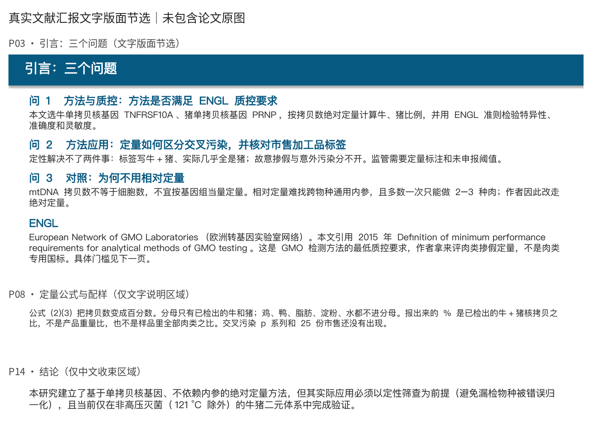

# paper2ppt：真实文献汇报文字版面节选

## 来源与可确认事实

- 文献：Chang et al. (2024), *Real-time PCR method based on single-copy nuclear DNA sequences for the quantitative detection of pork adulteration in processed beef products*. *Food Control*, 163, 110518。
- DOI：[10.1016/j.foodcont.2024.110518](https://doi.org/10.1016/j.foodcont.2024.110518)。本轮未访问出版商页面、未重新核验论文科学结论。
- 真实产物：既有项目 `Chang_2024_pork-adulteration-qPCR` 中的 `汇报/Chang_2024_文献汇报.pptx`，不是为效果展示新建的 PPT。
- 本轮读取的 PPTX SHA-256：`632c447e1029dd445c3ff5007be06ee85f05a5fe9cb3fe3524c1b12d694e6457`；转换前后相同，未修改原件。
- 只读解析确认：15 页，画布约 13.33264 × 7.5 英寸。所选内容为 PPT 内可编辑文字框，不是论文图片里的文字。
- 项目原有 `00.任务进度.md` 至 `05.验收记录.md` 等工作流产物。本轮读取了 `02.讨论与汇报主线.md` 和 `05.验收记录.md`：前者第 44–82 行记录“三问”组织方案，第 119–126 行记录制作、用户手改和后续修订。因此该汇报是历史工作流与人工修改的现有产物，不声称是未经人工编辑的一次性模型输出。
- `05.验收记录.md` 保存的历史哈希与本轮实际文件哈希不一致；本页以本轮实读结果为准，不继承旧记录的完整验收结论。

## 图片具体选取

页码按 PPTX 从 1 开始计数。三块均是汇报撰写者围绕已发表文献组织的解释文字，未选论文摘要或结论英文原文。

| 顺序 | 真实页码与位置 | 展示价值 | 明确排除 |
|---|---|---|---|
| 1 | P03「引言：三个问题」：页顶标题、三问及 ENGL 解释 | 展示问题式汇报主线、方法与质控、应用和对照的组织 | 裁去页面下部空白；该页没有图片对象 |
| 2 | P08「定量公式与配样」：中部以“公式 (2)(3) 把拷贝数变成百分数”开头的独立文字框 | 展示对百分数分母及解释边界的说明 | 上方论文公式图片、下方配样表，以及该页标题栏均未收录 |
| 3 | P14「结论」：下部以“本研究建立了基于单拷贝核基因”开头的中文收束文字框 | 展示定性筛查前提与牛猪二元体系的适用限制 | 上方英文结论原文及该页标题栏均未收录 |

P08/P14 的页码说明是本轮加在截图外的索引，不是原幻灯片标题栏。图片不是三张完整幻灯片，也不以裁切后的文字区域冒充完整页。

## 转换与裁切方式

1. 用 `python-pptx` 只读列出原 PPTX 各页文字、对象类型和位置，先选择文字区域再转换。
2. 用已有 LibreOffice 的 `--headless --convert-to pdf --outdir` 转换原 PPTX，另设独立 `UserInstallation`；PDF、转换配置和中间图片全部保留在临时区的唯一目录 `paper2ppt-showcase-UAy1Xrz8`，不进入仓库。未写回或另造源 PPT。
3. 用已有 `pdftoppm` 在 144 DPI 下仅渲染指定页的裁切窗口：`-f N -l N -singlefile -png -x 0 -y Y -W 1920 -H H`。原点为页左上角，单位为该 DPI 下的像素：

   | 页码 N | Y | H | 实际裁切范围 |
   |---|---:|---:|---|
   | 3 | 0 | 750 | `(0, 0, 1920, 750)` |
   | 8 | 342 | 169 | `(0, 342, 1920, 511)` |
   | 14 | 669 | 116 | `(0, 669, 1920, 785)` |

4. 用已有 Pillow 将各裁切图等比缩到宽 1360 px，再依次放入宽 1400 px 的白底图片；只增加页码索引和 caption“真实文献汇报文字版面节选｜未包含论文原图”。最终尺寸 **1400 × 1006 px**。原截图内的文字、换行、颜色和相对排版未重写；缩放不构成版权规避措施。
5. 仓库只新增本 provenance 文档和 `docs/images/paper2ppt.png`；不导出完整 PPTX、PDF、论文图表或其缩略图供分发。

## 实际检查与展示局限

- **真实来源**：完成源 PPTX 只读对象解析、来源段落对照与转换前后哈希核对；本轮仅展示既有产物，**未重新执行论文精读、讨论确认或 PPT 制作流程**。
- **结构检查**：实际运行现有 `inspect_pptx.py --require-notes --json`，返回 `ok: true`、15 页、15 个媒体项、15 页备注、无 errors。但 P02–P15 标题底色矩形均有向右约 **0.002707%** 的轻微越界 warning，不能表述为“零越界”。结构 QA 不等于完整视觉合规或科学验收。
- **实际读图**：本轮查看了三个裁切 PNG 和最终组合图，确认文字可读、无被切断的文字行、P08 未夹带上方公式或下方表格、P14 未夹带英文原文。图中未发现私人身份、本机绝对路径、引物序列或未发表数据。基因名称是已发表文献主题中的名称，不是引物序列。
- **隐私与版权范围**：本轮未确认论文原图存在适用于公开分发的许可；这不是对其版权状态作法律上的绝对认定。本展示采用保守范围，仅收录现有汇报中的中文组织/解释文字，不包含论文图表截图、公式图片、期刊封面、低分辨率缩略图或全文原图；不声称 DOI 引用或缩小图片即可获得转载许可，也不授予原文献或源产物的再分发权。
- **完整性限制**：本图不能代表整套 PPT 的视觉质量、图表可读性、讲述效果或科学正确性。原文字中的研究判断和简化表述忠实保留，不意味着本轮已逐句核验；例如 P03 的概括性判断并未在此重新做证据审查。
